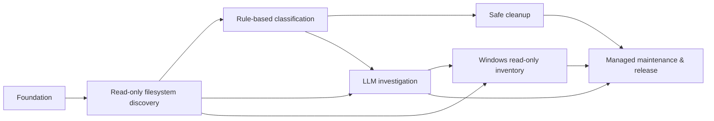

# DevCleaner v1 — Delivery Plan & Issue Graph

**Status:** updated planning baseline; GitHub entities have **not** been created.  
**Date:** 2026-10-15  
**Input:** `DevCleaner-v1-requirements-review.md`, user-approved decisions Q1–Q93, with Q25 subsequently clarified: no automatic quarantine cleanup.  
**Goal:** user-testable checkpoints, explicit dependencies, independent PRs, no mandatory implementation prescription.

## 1. Product decisions and contradictions

The previously approved decisions remain authoritative. This section does not silently replace user answers.

| Finding | Planning treatment | Status |
|---|---|---|
| Same-volume quarantine frees no immediate disk space | UI shows quarantined size and actual freed space separately | Interpret approved decisions |
| Quarantine data depends on app state; no backward-compatibility migrations | Preserve old state; refuse state reset with nonempty/unknown quarantine; restore/purge under compatible build first | Interpret approved decisions |
| Timed purge vs mandatory Dry Run and irreversible confirmation | **No automatic quarantine purge at all**. Optional age threshold can highlight items for **manual** disposal only | **Resolved AR-03** |
| Basic quarantine integrity check vs metadata preservation | Same-volume move and preflight capabilities preserve supported metadata; do **not** claim content integrity or independent reconstruction | Interpret approved decisions |
| Git internals excluded vs Git-aware protection | Git metadata can be read *only* for Git status and protections, never scanned as cleanup candidates or sent as arbitrary LLM context | Interpret approved decisions |
| Provider freedom vs tool/structured result support | Models that fail required capability tests cannot execute Investigation | Approved |
| Windows Restore Point may not create a new point | Represent attempted/new/existing/unavailable/failed states truthfully; explicit consent to proceed where newly created point not available | Interpret approved decisions |
| Official cleaner can irreversibly clear out-of-scope global caches | Special explicit user consent and transparent affected scope; no quarantine promise | Approved Q91–Q92 |
| Official cleaner successful exit may not equal desired effect | Require actual outcome checks where possible and Completed/Partially Completed/Failed/Unknown Result statuses | **Q93 approved B** |
| Automatic merge after independent review vs preflight approval | Two gates: user approves per-issue plan **before code**, reviewer approves PR **before agent merge** | Approved |

**Approved policy:** automatic quarantine deletion is out of scope without exceptions, including on startup and after an age threshold. Native-tool cleanup requires observed-outcome verification per Q93 B.

## 1A. Cross-cutting engineering contract for every Issue

**Status: approved as a global requirement.** OpenCode receives the following concise instructions **inside every posted issue body**, not only through the parent specification:

- **Modularity and reuse:** isolate independent check/detector/integration families with clear responsibilities; adding a check should not modify unrelated checks. No premature plugin framework or unnecessary layers.
- **Functional-first F#:** pure, composable domain logic with immutable models; use idiomatic modern F# constructs; keep external side effects explicit at the edges.
- **Exceptions and results:** expected failures return typed `Result`-like outcomes; translate .NET/Windows exceptions at integration boundaries via narrow `try/with` where appropriate. Preserve cancellation, unexpected faults, cleanup, and fail-closed behavior; do not claim universal absence of exceptions.
- **Readable and DRY:** small cohesive modules, explicit contracts, shared business invariants reused without overgeneralization; prioritize code clarity.
- **Agent conventions:** load canonical F# rules, commenting conventions, and the user's `one word` convention from current OpenCode instructions. Do not guess an undocumented convention.
- **Scope and verification:** the issue describes *what*, not *how*; implementation design remains OpenCode's responsibility after mandatory user-approved Preflight. Include relevant architectural rationale in the extended PR report; risk-based tests only.

**Authoring rule:** preserve this block when copying drafts to GitHub. Do not replace it with only a link to a repository-wide policy: each issue is intended to stand on its own as an agent prompt.

## 2. Milestones and release checkpoints

| Milestone | Issues | User-observable checkpoint |
|---|---:|---|
| M0 — Foundation & Portable Shell | 3 | Portable four-tab application launches; local state and diagnostics behave predictably. |
| M1 — Filesystem Discovery | 6 | User selects profiles, scans files, observes partial results, sizes and exclusions without any file mutations. |
| M2 — Rules, Classification & Git Protection | 5 | Known artifacts are classified; Git-aware protections and editable deterministic rules are demonstrated; still no cleanup. |
| M3 — Safe Cleanup & Recovery | 9 | Dry-run, same-volume quarantine, strict restore, crash recovery and confirmed cleanup flows are usable. |
| M4 — LLM Investigation | 8 | LLM investigates Unknown with bounded read-only tools, controlled web research, citations, cache and user approval. |
| M5 — Windows Read-only Investigation | 11 | All agreed Windows categories are inventoried read-only with owner grouping and individual provenance. |
| M6 — Managed Cleanup & v1 Release | 3 | Supported managed-cleanup operations and final portable ZIP v1 are validated and releasable. |

Milestones are **delivery checkpoints**, not mandates for particular layers, patterns, storage engines or libraries. Parallel execution is governed by issue dependencies, not a global M0→M6 sequence.

## 3. Explicit dependency model



**Meaning:** the diagram shows broad integration, not a requirement to wait for all of M4 before beginning M5. Individual dependencies below are authoritative.

## 4. Issue register

**IDs `DC-001…DC-045` are planning IDs, not existing GitHub issue numbers.** After publishing, map each to its real issue number and then use `GHI-<number>` with workflow-mcp `task`.

| ID | Milestone | Issue | Depends on |
|---|---|---|---|
| DC-001 | M0 | Portable F# desktop application shell | — |
| DC-002 | M0 | Portable state ownership and single-instance safeguards | DC-001 |
| DC-003 | M0 | App settings and local diagnostics | DC-002 |
| DC-004 | M1 | Scanning profiles and scope selection | DC-002, DC-003 |
| DC-005 | M1 | Adaptive filesystem metadata discovery | DC-004 |
| DC-006 | M1 | Scan progress, pause/resume, cancellation and transient errors | DC-005 |
| DC-007 | M1 | Hierarchical results and combined filters | DC-005, DC-003 |
| DC-008 | M1 | Disk usage estimation and filesystem capability awareness | DC-005 |
| DC-009 | M1 | Global exclusions and protected application state | DC-004, DC-005 |
| DC-010 | M2 | Declarative classification and conflict handling | DC-005, DC-009 |
| DC-011 | M2 | Known developer artifacts and cache classification | DC-010 |
| DC-012 | M2 | Rule editor, preview and live activation | DC-010, DC-007 |
| DC-013 | M2 | Full Git-aware protection for working trees | DC-005, DC-009, DC-010 |
| DC-014 | M2 | Recent-file and active-application safety signals | DC-005, DC-010 |
| DC-015 | M3 | Detailed dry-run and revalidated cleanup plan | DC-007, DC-008, DC-009, DC-010, DC-011, DC-013, DC-014 |
| DC-016 | M3 | Same-volume file quarantine | DC-015, DC-002, DC-008 |
| DC-017 | M3 | Strict restore and permanent quarantine removal | DC-016 |
| DC-018 | M3 | Crash-consistent cleanup history and resumption | DC-016, DC-017, DC-002 |
| DC-019 | M3 | Optional Windows Restore Point precondition | DC-003 |
| DC-020 | M3 | Filesystem links, cloud and removable safety at mutation time | DC-008, DC-009, DC-015, DC-016 |
| DC-021 | M3 | Blocked-file and active-process cleanup guidance | DC-014, DC-015 |
| DC-022 | M3 | Execute approved cleanup with safety gates | DC-015, DC-017, DC-018, DC-019, DC-020, DC-021 |
| DC-023 | M3 | Quarantine age visibility and manual disposal | DC-017, DC-018, DC-022 |
| DC-024 | M4 | Multi-provider LLM connections and ephemeral keys | DC-003, DC-002 |
| DC-025 | M4 | Privacy-controlled investigation context | DC-024, DC-005, DC-009 |
| DC-026 | M4 | LLM-accessible read-only local investigation tools | DC-025 |
| DC-027 | M4 | Multi-step investigation, budgets and cancellation | DC-026 |
| DC-028 | M4 | Public web research with network isolation | DC-027 |
| DC-029 | M4 | Evidence record, LLM cache and investigation history | DC-027, DC-002 |
| DC-030 | M4 | User-confirmed LLM classification and rule proposals | DC-010, DC-012, DC-027, DC-029 |
| DC-031 | M4 | Investigation user experience and provenance display | DC-007, DC-027, DC-028, DC-029, DC-030 |
| DC-032 | M5 | Installed software, services and startup inventory | DC-003, DC-007 |
| DC-033 | M5 | Registry residues and scheduled task inventory | DC-032 |
| DC-034 | M5 | Event log and environment inventory | DC-032 |
| DC-035 | M5 | Driver and shell extension inventory | DC-032 |
| DC-036 | M5 | Firewall rules inventory | DC-032 |
| DC-037 | M5 | Windows Update and component-store inventory | DC-032 |
| DC-038 | M5 | WSL distributions inventory | DC-032 |
| DC-039 | M5 | Docker and local container storage inventory | DC-032 |
| DC-040 | M5 | Virtual disk inventory | DC-032 |
| DC-041 | M5 | Windows Recycle Bin size insight | DC-032, DC-008 |
| DC-042 | M5 | Cross-system orphan correlation and Windows LLM evidence | DC-032, DC-033, DC-034, DC-035, DC-036, DC-037, DC-038, DC-039, DC-040, DC-027, DC-030 |
| DC-043 | M6 | Managed developer cache cleanup discovery | DC-011, DC-015, DC-022 |
| DC-044 | M6 | Controlled execution and verification of managed cleanup | DC-043, DC-019, DC-022 |
| DC-045 | M6 | v1 acceptance, portable ZIP and manual release | DC-023, DC-031, DC-041, DC-042, DC-044 |

## 5. Parallel-work recommendations

- **After DC-001/002:** local settings and scan-profile work are constrained by app state; no destructive operations yet.
- **After DC-005:** scan controls, results UI, storage estimates and exclusions can be pursued independently where their dependencies are met.
- **After DC-010:** known artifact rules, rule editor, Git protection and active-app safety signals can be developed in separate PRs.
- **After DC-015:** quarantine and Restore Point work are distinct; do not expose executable cleanup until DC-022's safeguards pass.
- **After DC-024–027:** LLM cache, public-web research and subsequent rule approval can proceed as their per-issue dependencies permit.
- **After DC-032:** Windows inventory issues DC-033…DC-041 are largely parallel and read-only.

**Safety release gate:** `DC-022` must not expose destructive operations before its dependency checks, required local tests and independent review. `DC-045` must verify no automatic quarantine cleanup exists, and native-tool results follow Q93 B.

## 6. GitHub project configuration

- **Project:** `DevCleaner — Roadmap` (create when repository/owner confirmed).
- **View:** Kanban grouped by Status; optional roadmap/table view for dependencies.
- **Statuses:** `Backlog`, `Ready`, `In Progress`, `In Review`, `Blocked`, `Done`.
- **Milestone:** M0–M6 as GitHub milestones; GitHub Projects can also display milestone as a field where available.
- **Priority:** P0 (safety blocker), P1 (necessary v1), P2 (polish). Default safety issues P0; other planned v1 issues P1.
- **Dependency:** native issue blocked-by links where supported; descriptions include canonical links.
- **Assignment:** user manually starts issues; agents update statuses and report any blockers.
- **Preflight:** required on every issue; even `Ready` does not authorize code. Agent must get explicit user approval of its plan before writing code.
- **Review and merge:** independent English PR review; blocking comments fixed; reviewer confirms; agent may merge into `main` after successful local checks, then close issue/mark Done.

## 7. Issue contract

Each issue includes **Goal, Scope, Out of Scope, Acceptance Criteria, Dependencies, Constraints & Invariants, Verification**. Rules for authoring:

- Describe externally observable results, restrictions and failure modes. Do not prescribe classes, folder layout, concrete APIs, architectural patterns or code implementation unless an approved invariant demands it.
- Copy the project-wide Engineering Contract into **each** issue, immediately after Goal (or before Goal when using prepared drafts), so agent context is self-contained. This sets quality constraints without dictating implementation.
- Include only necessary tests; test catastrophic data-loss/security boundaries explicitly.
- Avoid backward compatibility and legacy paths; roll forward. No unnecessary abstraction, plugin host or speculative extensibility.
- Scope change requires advance approval, even when an improvement looks useful.
- An agent must verify the issue against current `main`, dependency readiness and existing work before proposing a plan.
- PR must state goal, AC status, local checks, major design decisions/tradeoffs, contract changes, risks and limitations.

### Template
```markdown
# [Concise user-visible outcome]

## Goal
[What success means for the user]

## Project-wide Engineering Contract
[Insert the approved compact functional-first F# / modularity / typed-result error-boundary / readable-composition / OpenCode-conventions block verbatim from the issue drafts.]

## Scope
[Required behavior and supported scenarios]

## Out of Scope
[Adjacent capabilities intentionally excluded]

## Acceptance Criteria
- [ ] [Observable, testable result]
- [ ] [Failure case / safety boundary, where relevant]

## Dependencies
- Blocked by: [links or None]

## Constraints & Invariants
- Follow DevCleaner v1 requirements and global safety invariants.
- No speculative abstractions, legacy compatibility or uncontrolled scope growth.
- Implementation design belongs to OpenCode.

## Verification
- [Minimal local checks appropriate to risk]

## OpenCode Workflow
- Run preflight against current main and dependency status.
- Present implementation plan; wait for explicit user approval before code.
- Open PR with extended engineering report; address independent review findings.
- Merge only after approval and local verification; update GitHub Project status.
```

## 8. Confirmed cleanup policies

1. **AR-03 resolved:** no timed, scheduled, on-startup or unattended deletion of quarantined objects. Optional age indicators are informational; final deletion is always a user-initiated, confirmed action.
2. **Q93 B approved:** compare actual and expected effects of official-tool cleanup when verifiable, record Completed/Partially Completed/Failed/Unknown Result and evidence, never blindly retry an operation with an uncertain outcome.

## 9. Ready-to-post descriptions

See `DevCleaner-v1-GitHub-issue-drafts.md`. Do not publish drafts until repository identity and milestone mapping are available. Full original decisions stay in `DevCleaner-v1-requirements-review.md`.
